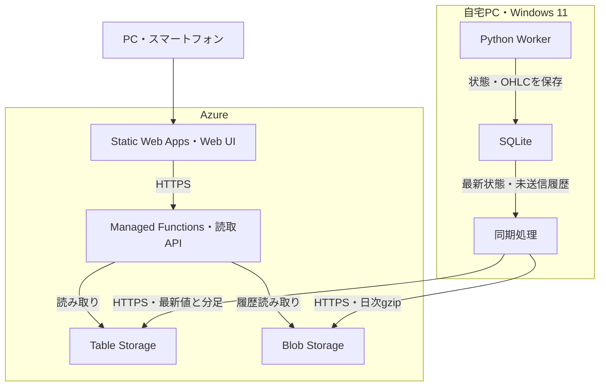

# リソース管理シミュレータ 基本設計書

- 文書バージョン：0.5
- 作成日：2026-10-11／更新日：2026-10-22
- 対象：PC Worker + Azure公開／保存構成のMVP
- 上位文書：[要件定義書 0.5](resource-simulator-requirements.md)（従来のMVP要件・ACを維持し最新値先行公開を追記）
- 位置付け：要件を実現する配置、技術構成、処理、データ、API、運用の初期設計。
- 状態：Azure採用とユーザー提示条件は確定。サービスの個別構成・数値モデル等は設計上の初期案。デプロイ／実機検証は未実施。

段階1のローカルWorkerは実装済み。Windows上での検証結果と未検証範囲は[段階1検証記録](stage1-validation.md)を参照する。Azureの実機検証は未実施。

改訂履歴：0.2（2026-10-11）で初回取得と自動反映を明記し、最新値のポーリング初期案を2秒から1秒へ変更した。

0.3（2026-10-22）：ユーザー指示によりWorkerのPython 3.10前提を撤回し、3.13系の最新パッチ候補を確認して3.13.16へ固定。外部依存なしで設定を読み込むためYAML初期案をTOMLへ変更し、段階1の保存・ロック・復元・実装配置を具体化した。計算式・計算例・API契約・AC-01〜20は変更しない。クラウドAPIのランタイムは引き続き別途検証する。

0.4（2026-10-22）：`cf351ea`のレビューに基づき計算周期の期限更新を修正。段階2での送信済みoutbox削除・退避済みOHLC削除後の再開、欠落検出、スキーマ版1→2の保全付き移行を[保存・移行設計0.1](resource-simulator-storage-design.md)として具体化した。今回は周期修正・テスト・設計のみであり、保存コードは版1のまま。計算モデル、API契約、要件定義書0.4の要件・ACは変更しない。

0.5（2026-10-22）：`51ba06c`を基準に最新値先行公開を実装。詳細は[構築・運用記録](azure-latest-values.md)と[最新値公開の検証記録](latest-values-validation.md)。別スレッドでコミット済みcheckpointのみを読み、ETagとrun_generationで巻戻りを防止する。APIはPython 3.11＋azure-functions 1.25.0、WebはReact/TypeScript/Vite。OHLC・outboxを変更・削除しないためDBは版1を維持し、復元検査は弱めない。版2移行・履歴同期は後続。

## 1. 設計思想と決定理由

### 1.1 文書の役割分担

| 内容 | 記載先 | 例 |
| --- | --- | --- |
| 利用者、目的、必要な振る舞い | 要件定義書 | 外出先から閲覧、PC停止中も保存済み履歴を閲覧 |
| ユーザー指定の制約 | 要件定義書 | Azure採用、月1,500円目標、ローカル操作、約100リソースまで |
| 検証する完了条件 | 要件定義書 | 再起動で最新保存状態から再開、1分OHLCの整合性 |
| 配置・サービス・通信方式 | 基本設計書 | SQLite、Table Storage、Managed Functions、HTTPSポーリング |
| 状態復元・同期・退避の方式 | 基本設計書 | トランザクション、未送信キュー、日次gzipファイル |
| 実装の詳細 | 実装時の詳細設計／README | SQL DDL、確定したSDKバージョン、Azure構築コマンド |

要件が変わる場合は上位文書を改訂する。実現方式だけを変更する場合は本書を改訂し、要件IDとの対応を維持する。

### 1.2 アーキテクチャ原則

1. シミュレーションの計算と復旧の正本を自宅PCに置く。クラウドは公開・参照・履歴保管を担当する。
2. 最新計算状態の保存と通信を分離する。通信失敗だけでは計算を止めない。
3. PCからAzureへ接続する。クラウドからPCへ接続する経路を作らない。
4. ブラウザは共有シミュレーションを閲覧する。画面のライフサイクルを計算に結び付けない。
5. 1秒計算、1秒の最新同期、1分OHLC、日次ファイルという粒度を分離する。
6. 約100リソースを想定するが、MVPの本実装は1リソース・1パラメータに絞る。

Azureは既存の知見と小規模な公開・保存構成を優先して採用する。AWSとの料金上の優劣を本書の根拠にしない。前回提示した「数十〜数百円」の金額は確定見積もりとして引き継がない。

## 2. 全体構成と責務



| 機能 | 配置・担当 | 責務 |
| --- | --- | --- |
| パラメータ・リソース更新 | PC / Engine | 1秒ステップの計算・検証 |
| 実行制御・設定 | PC / Worker | 起動、停止、設定読込、単一起動 |
| 状態復元元 | PC / SQLite | 最後のコミット済み状態、分内集計、未送信履歴 |
| OHLC生成 | PC / Aggregator | 計算済み値を実日時の1分単位で集約 |
| クラウド同期 | PC / Sync | 非同期の送信、再試行、日次化・退避 |
| 最新公開状態 | Azure / Table | 共有シミュレーションの最新スナップショット |
| 直近の未日次化OHLC | Azure / Table | 分足を日次ファイルが完成するまで提供 |
| 日次履歴・圧縮退避 | Azure / Blob | 日次・リソース単位のgzip、古い履歴の保管 |
| Web・Read API | Azure / SWA + Functions | 最新値・期間指定OHLCを読み取る |
| 更新停滞判定 | API + Web | 最終公開日時の古さを示す。PCの死活を断定しない |

ローカルSQLiteは復旧の正本であり、Azureの最新公開状態は復旧の正本にしない。公開スナップショットとOHLCだけでは完全なローカル状態を再構成できるとは保証しない。

## 3. 技術スタック

| 層 | 初期選定 | 補足 |
| --- | --- | --- |
| PC環境 | Windows 11、PowerShell、VSCode、uv | 既存のシステムPython・PATH・レジストリ・他プロジェクトを変更しない |
| Worker | CPython 3.13.16、標準sqlite3 | 3.13系の最新パッチ候補を公式一覧・uvで確認し、段階1の互換性をWindows上で検証。Python本体は`.tools/python`、環境は`.venv`。Azure SDKは段階2で別途検証・固定 |
| 設定 | TOML、標準tomllib、dataclassによる検証 | 段階1は外部実行・開発依存なし。未知・欠落キー、型、有限性、範囲を検証。秘密情報を設定ファイルに混在させない |
| プロセス管理 | Windowsタスクスケジューラ | 起動時実行・失敗時再起動・二重起動抑止 |
| コンテナ | MVPでは利用しない | 1台のPC・1 Workerでは追加の管理層を抑える。Docker禁止の意味ではない |
| Web | React + TypeScript + Vite | 閲覧専用、ローソク足対応の軽量グラフを利用。ライブラリは実装時に選定 |
| Web公開 | Azure Static Web Apps Free | 初期候補。料金・制限・必要帯域は公開前に再確認 |
| Read API | SWA Managed Azure Functions / Python 3.11 | HTTPのみを使用する。PCとAPIでPythonの版を一致させる必要はない |
| 最新値・分足 | Azure Table Storage | Cosmos DBや常駐DBを導入しない |
| 日次履歴・古い履歴 | Azure Blob Storage | Standard GPv2、LRSを初期候補とする |
| 履歴形式 | JSON + gzip | 日次・リソース単位。圧縮は初回ファイル作成時から実施 |
| 基盤定義 | Bicep、バージョン管理 | 課金する常駐VMやApp Serviceプランは置かない |

最新値先行公開ではWorkerにazure-data-tables 12.7.0・azure-identity 1.26.0を追加し、全推移依存をuv.lockへ固定した。APIはPython 3.11.17で互換性を検証し、全依存をapi/requirements.txtへ固定。現行azure-functions 2系はPython>=3.13のためManaged Functionsの3.11では使わず、1.25.0を選んだ。APIはWorkerのpyprojectを参照しない。uvは`python-downloads=manual`として明示インストールだけを許し、自動ダウンロードを行わない。

WorkerとクラウドAPIのランタイムは独立して選定する。2026-10-11に確認したSWA対応表ではPython 3.11がManaged Functionsに掲載されていたため、クラウドAPIは3.11を初期候補としている。今回のWorker変更をAPIへ適用しない。API実装時に最新の対応表・サポート期限・SDK互換性を再確認する（参考資料S-01、S-02）。

2026-10-21〜22のWorker環境確認では、Python公式一覧の3.13系最新パッチ版とuv 0.13.4の配布候補は3.13.16だった。`.python-version`と`requires-python ==3.13.16`、依存解決の`uv.lock`で固定する。段階1は標準ライブラリの`tomllib`・`sqlite3`・`msvcrt`・`unittest`等を使い、外部ライブラリは追加しない。設定をTOMLに変更する理由は、Python 3.13標準機能で安全な設定読込と検証を行えるためである。Python本体の配布はuvのpython-build-standalone（20261013ビルド）を使用する。

Managed FunctionsはHTTPのみで、Managed IdentityとKey Vault参照を利用できない（S-03）。本設計ではTimer Trigger、Blob Trigger、Managed Identityを前提にしない。Python APIの依存はrequirements.txtとしてデプロイし、uvをクラウドの起動要件にしない。

## 4. 計算モデルの初期案

旧要件定義書0.1の計算案を継承する。これはユーザーが具体値を指定した確定条件ではない。

| 項目 | 既定値／仕様 |
| --- | --- |
| リソースRの初期値 | 100 |
| パラメータPの初期値 | 0 |
| パラメータ更新 | 各ステップで独立な一様乱数、−1以上1未満 |
| 比例係数k | 10 |
| シミュレーション時間Δt | 1秒 |
| リソース下限 | 0、上限なし |
| 内部精度 | 浮動小数、表示用の丸めを計算に持ち込まない |
| フィードバック | パラメータ→リソースの一方向のみ |

更新は次の順序とする。

```text
u_n = 乱数源から取得（0以上1未満、ステップにつき1回）
P_n = P_min + (P_max - P_min) × u_n
requested_delta = k × P_n × 1
R_n = max(0, R_(n-1) + requested_delta)
actual_delta = R_n - R_(n-1)
step = step + 1
simulation_elapsed_seconds = step × 1
```

新しい値を全て検証した後に確定する。下限で切り捨てた減少分は繰り越さない。下限を適用すると0付近で正負の変化が対称でなくなることは仕様どおりとする。

固定乱数u=0.25、0.9、0.0の場合、P=−0.5、0.8、−1.0、R=95、103、93となる。R=3でP=−0.8の場合、R=0、要求−8、実増減−3となり、次にP=0.5ならR=5となる。

初期設定、入力、出力は有限値であることを検証する。初期R≥0、P_min<P_max、P初期値が生成範囲内、k≥0、周期1秒を検証する。NaN／Infinity等が出た場合は最後の正常保存状態を維持して計算を停止する。

## 5. Workerの実行・保存・再開

### 5.1 起動と設定

1. ローカルプロセスロックを取得し、二重起動なら終了する。
2. 設定ファイルを検証し、SQLiteの整合性・スキーマバージョンを確認する。
3. 保存状態があれば復元する。なければ初期状態を作り、実行IDを採番する。
4. 未確定OHLCと未送信キューを復元し、過去の未完了日次化も検出する。
5. 約1秒後から最初の計算を実行する。同期処理を別の実行経路で動かす。

起動時に通常実行を開始し、ブラウザの開始操作を要求しない。保存状態のRを設定ファイルの初期値で上書きしない。新しい初期値／規則で開始するときは明示したローカル初期化コマンドを使い、別のrun_idを発行する。初期値項目は復旧時に適用せず、保存状態を優先する。設定全体のハッシュとは別に、初期値を除く計算規則のハッシュを持つ。計算規則が既存の実行と異なる場合は、暗黙に新規則を適用せず、保存した規則での復旧か新規実行かをローカル操作で解決する。

段階1では設定検証をDB変更前に行い、DBの絶対パスに対応する永続ロックファイルをWindowsの`msvcrt.locking`で非待機ロックする。同じDBを使う`run`・`new-run`は同じロックを取得する。強制終了時はOSが解放し、ロックファイルは削除しない。DBはネットワーク共有・同期フォルダーでなくローカルディスクへ置く。設定ファイルを分けても同じシミュレーションは同じDBパスで起動する。

通常実行は`python -m resource_simulator run`、保存済み規則を明示的に選ぶ場合は`--use-saved-rules`、新しい実行は`new-run`コマンドとする。`new-run`は旧実行の分内集計を確定し未送信記録とともに保持した上で、新しい実行のstep=0を保存する。通常停止では分内状態を未確定のまま残す。

### 5.2 1ステップの保存

計算スレッドは時計の待機にmonotonic clockを使用し、記録用にはUTCのwall clockを使用する。初回期限は起動時の単調時計+1秒。各ステップの計算・保存完了後は、通常は前回の予定期限に1秒を加える。保存時間を毎周期に加算しない。完了時刻が次の予定期限以上なら、完了時刻+1秒へ期限を立て直し、過ぎた期限のステップを高速で追いつき計算しない。期限と完了がちょうど同時の場合も立て直す。スリープで待機から遅れて戻った際は実行する1ステップだけ進め、保存完了後に同じ規則を使う。

固定時計で起動時刻=0、保存時間=0.2秒の場合、通常の開始予定は1.0、2.0、3.0秒、待機は1.0、0.8、0.8秒となる。保存時間=1.2秒で次期限を超える場合、開始は1.0、3.2、5.4秒となる。最初の待機で3600秒のスリープが入り保存に0.2秒かかる場合、開始は3601.0、3602.2秒で、停止中のステップは追加しない。周期の壁時計上の厳密保証は引き続き対象外（NF-02）。

SQLiteの1トランザクションで、以下を同時に確定する。

- 更新後のステップ・リソース・パラメータ・増減量・観測日時。
- 当該分のOHLC、sample_count、最初／最後の観測日時。
- 分境界で確定したOHLCと、その未送信記録。
- 乱数生成器の復旧情報を保持する場合はその状態も同時に保存する。

コミット後の状態だけを最新として扱い、公開する。乱数状態を保存する場合は安全な明示形式を使用し、クラウドから取得したpickleを復元しない。シード指定の実験比較はMVPの対象外である。

SQLiteはWALと適切な耐久設定を使い、保存失敗は計算停止の理由にする。計算側と同期側ではDB接続を分け、短いトランザクションを使う。ライブDBのバックアップにはSQLite Backup API等を使い、WAL使用中にDBファイルだけを単純コピーしない。

### 5.3 停止と復旧

正常停止は停止フラグを使い、途中の計算を新たに開始せず、最後のトランザクションを完了する。分内OHLCは未確定のまま保存してよい。強制終了・停電の場合も最後のコミット済み状態から復元する。コミット前の1ステップは失われ得る。

PC停止中の実時間は経過ステップに加算しない。再起動から約1秒後に次のステップへ進む。PCが停止している間はAzureで代替計算しない。

### 5.4 ローカルデータの最小構造

| 論理テーブル | 主な情報 | 役割 |
| --- | --- | --- |
| simulation_runs | simulator_id、run_id、設定、設定ハッシュ、計算規則ハッシュ、開始日時、schema_version | 実行と規則の識別 |
| active_run | 単一の現在run_id | 再開する実行の参照 |
| checkpoints | run_id、step、R、P、増減量、計算日時、必要な乱数状態 | 最新の復元元 |
| open_candles | run_id、resource_id、minute_start、O/H/L/C、sample_count | 分の途中の復元 |
| candles | run_id、resource_id、minute_start、O/H/L/C、観測範囲 | 確定した分足 |
| outbox | データ種別、対象キー、試行回数、次回試行時刻、送信状態 | 永続的な未送信キュー |
| daily_files | 日付、resource_id、hash、クラウド保存先、完了状態 | 日次化・退避・再試行の追跡 |

1秒値の全履歴をSQLiteに無期限蓄積しない。最新checkpointとOHLCを保存する。ローカルOHLCはクラウドへの保存確認後も最低3か月保持する初期案とし、それ以前は退避確認後に削除できる。未送信データは期間だけを理由に削除しない。DBスキーマや具体的なSQLは実装時に確定する。

段階1の実スキーマは`resource_simulator/persistence.py`で定義する。スキーマ版は`PRAGMA user_version=1`、simulatorはDBごとに1個、resource_idは`resource`固定である。設定・checkpoint・OHLCは有限値を検証したJSONで保存し、識別キーと参照はSQLiteの主キー・外部キーで管理する。未対応スキーマや既存の別DBを自動初期化しない。起動時に整合性・外部キー・設定ハッシュ・checkpointとOHLCのサンプル総数・最終値を検証する。

確定OHLCとoutboxのキーは`(run_id, resource_id, minute_start)`。段階1でも確定足と未送信記録を同一トランザクションで作り、再開時の整合性を保つ。送信・送信済み管理・日次化・削除は段階2以降で実装し、この段階では保存した履歴もoutboxも削除しない。日次管理テーブルはまだ作成しない。

### 5.5 段階2の保存・移行仕様（今回の設計範囲）

段階2では版1の「全確定足にoutbox必須」「残存OHLCのcount合計=step」という検査をそのまま使わない。[ローカル保存・移行設計0.1](resource-simulator-storage-design.md)を本節の詳細仕様とする。分ごとの永続台帳でpending/ackedとretained/prunedを区別し、outboxはpendingにだけ要求する。確定・削除済みの累積サンプル数と最後の確定位置を保持して、本体削除後にもcheckpointとの整合性と未送信欠落を検査する。

版2への移行は、全runの版1検査・照合済みBackup APIバックアップを先に行い、DDL・データ変換・検査・版更新を1トランザクションで実施する。欠落から送信済み／退避済みを推測せず、失敗時は停止・ROLLBACK・バックアップ保全とする。今回の`persistence.py`と実DBは版1のままなので、outbox／OHLCの手動削除は依然禁止。移行・同期・削除の実装と障害試験は段階2の残作業である。

## 6. OHLC・日次履歴・期間管理

### 6.1 時刻とOHLCの定義

内部日時はUTCのISO 8601とし、画面表示・日次ファイル・閲覧境界にはAsia/Tokyoを使う。1分は実時間の半開区間 `[分の開始, 次の分の開始)` とする。値はその分に観測した計算完了後のRを使用する。

| 値 | 定義 |
| --- | --- |
| open | 分内の最初の計算完了値 |
| high | 分内の最大値 |
| low | 分内の最小値 |
| close | 分内の最後の計算完了値 |
| sample_count | 分内の計算完了サンプル数 |
| first_observed_at / last_observed_at | 分内の実際の最初／最後の観測日時 |

初期状態step=0は計算サンプルに含めない。サンプル1個ならO=H=L=Cとする。0個ならOHLCを生成しない。部分稼働の分には実サンプルだけを使用し、sample_count等で不完全な区間を判別する。ブラウザで未確定の分を表示する場合は「形成中」と表示し、確定足と区別する。

分境界のステップでは前の分を確定し、新しい分を開始する。停止前の未確定分は再起動時に復元し、同じ分なら継続、後の分なら以前の分を確定する。日付変更・PC時刻の逆戻りも検出し、既に確定した過去の分に新しいサンプルを追加しない。時計異常時は記録を止めて原因をログに残す。

### 6.2 Tableから日次Blobへの移行

原則は「完了した日を日次化する」だが、PCが日付変更前後に停止する場合も考慮する。

1. 各分の確定OHLCをTableへ再送可能な形で同期する。
2. 日付が閉じたら、リソースごとにその日の全OHLCをSQLiteからJSONにまとめgzip圧縮する。
3. 日次Blobへアップロードし、整合性を確認する。
4. 日次完了マニフェストを更新する。全リソースが保存できるまでその日の完了を宣言しない。
5. Tableの当該分足は、完了確認後の猶予期間（初期案7日）を経て削除できる。

Worker起動時も未完了の日を再処理する。日次Blobが未作成ならRead APIはTableへフォールバックする。したがって日次化が終わっていない昨日以前の分足を、日付だけを理由にTableから削除しない。PCが停止中でも同期済みの過去日データは閲覧できる。

日次化はUTC+9の日単位で、Blob内の各minute_startはUTCで保持する。1日あたり最大1,440行／リソースを基本とする。gzipはHTTPのContent-Encodingとして透過展開させる用途と混同せず、ファイル形式として扱う。APIで展開・検証し、必要なリソース・期間だけを返す。

### 6.3 3か月の境界と古い履歴

要件の3か月は暦上3か月と解釈する。APIは現在の日本時間から3か月を引いた境界を計算し、通常履歴取得に適用する。存在しない月末日はその月の末日に合わせる。例：2026-05-31から3か月前は2026-02-28。

日次ファイルを退避するのは、その日の全ての分足が境界より古くなった後とする。境界日のファイルは日付だけで除外せず、APIで行を時刻により絞る。

通常履歴用の非公開コンテナ`history`と、退避用の非公開コンテナ`archive`を分ける。日次化した時点で全ファイルをgzip圧縮し、3か月後は圧縮済みファイルの配置を移す。重複して再圧縮する必要はない。

退避手順は、対象抽出→退避先に保存→圧縮ファイルの読戻し・展開内容の照合→完了記録→通常領域の削除とする。失敗時は元データを保持し再実行する。PC停止時に退避処理が遅れても、APIが期間境界を適用するため通常閲覧範囲は広がらない。

退避コンテナの初期アクセス層はHotのままとし、保存量・読出し要否・移行費を評価してArchiveアクセス層を有効化する。ユーザー指定は「圧縮して外出し」であり、AzureのArchive層利用まで確定していない。Archiveは即時読出しできず、復元作業と時間が必要で、180日の最低保存期間に関する早期削除料金もある（S-05）。

Archive層を採用した場合のみ退避コンテナにLifecycle Policyを設定する。LifecycleはBlob作成／更新からの日数を使うため、データの観測日時や暦上3か月と一致するとは限らない。再送された古いファイルや復元ファイルの再退避も考慮し、通常履歴コンテナに単純な「更新後90日でArchive」を設定しない。自動削除は設定しない。

## 7. Azureデータ設計

### 7.1 最新状態：CurrentState

| 項目 | 初期案 |
| --- | --- |
| PartitionKey | simulator_id |
| RowKey | current |
| 識別情報 | schema_version、run_id、step、config_version |
| 時間 | calculated_at、published_at、simulation_elapsed_seconds |
| 状態 | worker_state、異常時の短い公開用メッセージ |
| データ | resources_payload：全リソースの最新値・P・増減量をコンパクトなJSONで格納 |

全リソースを1スナップショットにして、同じステップの状態を一括公開する。内部の詳細エラー、PCパス、秘密情報を含めない。

TableのEntity全体は最大1MiBだが、単一文字列プロパティには64KiBの制限がある（S-04）。UTF-16の実サイズも考慮し、payloadに48KiBの設計上限を設ける。名称・説明等を毎秒データに重複させない。想定100リソースの最大値を含むサイズを実装段階で測定し、超える場合はBlobスナップショットと参照Entityへ変更する等、本節を改訂する。1MiBに収まるという理由だけでJSON文字列の格納可否を判断しない。

最新状態は単一同期経路で送信する。要求が不確定に終了した場合はETag付き条件更新と読み直しを使い、遅延した旧要求が新しい値を上書きしないようにする。単一run内のstepは後退させない。新規runへの切替時は旧runの同期経路を終了し、currentを切り替える。

### 7.2 分足：MinuteOHLC

| 項目 | 初期案 |
| --- | --- |
| PartitionKey | simulator_id + run_id + 日本時間YYYYMMDD |
| RowKey | resource_id + ':' + 日本時間HHmm |
| データ | minute_start（UTC）、open、high、low、close、sample_count、最初／最後の観測日時 |
| 段階2の保存メタデータ | schema_version、first_step、last_step、payload_hash、canonicalizer_version。台帳とクラウド読戻しの照合に使用し、公開APIの必須返却項目は増やさない |
| 一意性 | 実行・リソース・分をキーとしてupsertする |

resource_idは区切り文字を含めない固定形式とする。APIはPartitionKeyとRowKeyの範囲で、特定リソースの分足を取得する。Continuation Tokenでページングし、1回の応答で全件取得できるとは仮定しない。

前回の「100リソースを1分につき1 Entity」の提案から、検索・サイズ管理を優先して「1リソース×1分で1 Entity」に変更する。同じ分・同じ日・同じ実行のEntityは同一Partition内なので、サービスの件数・要求サイズ制限内で最大100件をまとめて送る。バッチ化は100個のEntity操作を課金上1操作にする保証ではない。費用見積もりではEntity操作数とHTTP要求数を分ける。

### 7.3 日次履歴：Blob

```text
history/{simulator_id}/{run_id}/YYYY/MM/DD/{resource_id}.json.gz
history/{simulator_id}/{run_id}/YYYY/MM/DD/manifest.json
archive/{simulator_id}/{run_id}/YYYY/MM/DD/{resource_id}.json.gz
```

パス先頭はコンテナ名である。日次ファイルはschema_version、run_id、resource_id、対象日、時刻系、行数、OHLC配列を持つ。マニフェストにリソース一覧・行数・hash・日次完了状態を記録する。公開のrun一覧と設定説明は秘密を除いたメタデータとして管理する。

1日1ファイル／リソースにすることで、閲覧する1リソースのために100リソース分を転送しない。初期MVPでは1日1ファイルである。1日全体が停止なら分足はなく、その日の欠測を示すマニフェストを必要に応じて残す。

## 8. クラウド同期と障害対応

| 種別 | 正常時の頻度 | 失敗時 |
| --- | --- | --- |
| 最新状態 | 約1秒 | 中間の古いスナップショットはまとめ、最新のコミット済み状態を送る |
| 確定OHLC | 分確定時 | 永続outboxへ残し、全て再送する |
| 日次Blob | 日付完了時・Worker再起動時 | 未完了の過去日も処理する |
| 古い履歴退避 | 起動時・1日1回 | 成功確認前は元データを保持する |

タイムアウト、指数バックオフ、jitterを用意する。通信処理は計算のトランザクション内で実行しない。未送信の最新値を秒ごとに無期限蓄積せず、OHLCの未送信は省略しない。outboxの増大とPCディスク残容量を監視する。

「OFFLINE」はPC故障の確定判定ではない。正常時は最新公開が10秒以上更新されなければ「更新停止／通信待ち」とする初期案。APIの現在時刻とpublished_atから鮮度を判定し、calculated_atも別に示す。復旧後の古い再送を、新しい計算が動いている証拠として扱わない。Workerが正常停止を公開できた場合はその停止状態も表示する。

API障害時はWebで最後に取得した状態を残し、「データ取得失敗」を表示する。データ未作成なら空状態を表示する。同期が一時的に戻った場合も、取り込んだデータの計算日時が古ければその旨を表示する。

## 9. WebとRead API

### 9.1 APIの初期契約

今回実装するのはGET /api/currentのみ。返却はschema_version、run_id、run_generation、step、R/P相当のresource/parameter、requested_delta、actual_delta、calculated_at、published_at、api_time、simulation_elapsed_seconds、model、stale、stale_after_seconds、history_available=false、build_commit。Tableのサービス側Timestampをpublished_atとし、no-storeを返す。未作成404、読取障害503は固定の公開用エラーのみを返す。/api/runsと/api/ohlcは未実装で、仮の値を返さない。

run_generationは版1の追加専用simulation_runs.rowid。runの削除・採番変更は禁止し、将来の移行でも保持する。同じ世代の別UUIDや世代の後退は送信・画面とも拒否する。詳細な同期手順・認証・料金と今回の構築先は[構築・運用](azure-latest-values.md)を正本とする。既存の履歴API契約は後続実装用として維持する。

| API | 内容 | 制約 |
| --- | --- | --- |
| GET /api/current | 最新公開状態、API時刻、更新の鮮度 | 未作成時は区別可能な404等を返す |
| GET /api/runs | 公開対象実行一覧・モデルの説明 | 秘密やローカルパスを返さない |
| GET /api/ohlc | run_id、resource_id、from、toの分足 | 対象3か月内、半開区間、1要求最大7日を初期案とする |

OHLC取得は日次完了分をBlob、未完了分をTableから読み、キーで重複排除し時系列に並べる。ページング用cursorを設け、返却行数上限（初期案10,080行）を適用する。3か月全体は分割して取得する。対象期間外、無効なresource_id、不正日時を検証する。

MVPの初期表示は最新状態と当日分足とする。画面アクセス時はタイマーの初回待機を挟まずGET /api/currentを呼び出し、成功応答の最新公開状態を表示する。前景での閲覧中は1秒間隔を目標にHTTPSポーリングし、新しい状態を取得するたびに最新値カードと更新情報を動的に反映する。ページ再読み込みや手動更新は不要とする（UI-01・UI-11）。確定OHLCは1分間隔／期間変更時に取得し、最新値の毎秒更新をOHLCの確定待ちにしない。WebSocketやSignalRは追加しない。バックグラウンドタブでは取得を止め、前景へ戻ったら即取得する。これはブラウザの通信制御であり、Worker計算の停止ではない。

GET /api/currentはCache-Control: no-storeを返し、ブラウザもキャッシュを使用せず取得する。API内部に古いcurrentを返すキャッシュを設けない。同じ取得ループでは前回要求の完了前に次を重ねず、タイムアウトを設定する。API通信の回復を検知したら即時再取得して通常の取得ループを継続する。

PC同期とWeb取得は独立した周期である。1秒ポーリングは毎ステップを必ず描画する保証ではなく、正常時に毎秒の変化へ追従する方式である。通信遅延や要求タイムアウト時は途中の値を飛ばして最新公開状態へ追従する。全ステップの表示が必要になった場合は別途配信・再生方式を設計する。初回応答時間とcalculated_atから画面反映までの遅延を実装時に測定する。

データ取得の競合時は古い応答で画面を戻さない。同一run内のstepと要求番号で比較し、run切替はcurrentのrun_idに従う。秒値の長期折れ線を必須にせず、1分OHLCを永続履歴として使う。3か月全体を扱う表示では取得を分割し、必要に応じて複数分を集約描画する。原本の1分OHLCは変更しない。

### 9.2 画面構成

- 最新値カード：R、P、実増減量、ステップ／計算経過時間。
- 更新情報：計算日時、公開日時、更新停滞、API通信状態。
- 推移：リソースの1分OHLC、期間選択、欠測・形成中の表示。
- モデル説明：現在の実行に使われている係数・範囲・下限。

スマートフォンでは縦配置し、横スクロールを必須にしない。Worker操作用の開始／停止／リセットボタンを置かない。

## 10. 認証・秘密情報・通信

### 10.1 閲覧

MVPは匿名閲覧を初期案とする。URLを知る人向けの運用でも、技術的には第三者が閲覧できる。シミュレーションの公開データだけを返し、本人情報やPC情報を出さない。招待者だけに制限する要件が加われば、SWAの認証・権限制御を追加設計する。URL自体を認証情報と扱わない。

### 10.2 Workerの書き込み

PCはEntraのサービスプリンシパルと証明書を使う非対話認証を初期案とし、Azure SDKでTable／Blobへ直接書き込む。証明書・秘密鍵をGitや共有設定に含めず、タスク実行ユーザーが安全に読み取れる場所へ保管する。Table書き込み、履歴・退避コンテナ書き込み等の必要なデータ権限を付与する。Azureサブスクリプション全体のOwner権限をWorkerへ渡さない。

### 10.3 Read APIの読み取り

Managed FunctionsにManaged Identityを仮定しない。読み取り専用のTable SASとBlob SASをサーバー側アプリ設定へ保管する初期案とし、有効期限・ローテーション手順を用意する。権限を対象テーブル／通常履歴コンテナの読取に絞る。退避コンテナへの読取権限は通常APIに与えない。

SASやStorageアカウントキーをWebへ返さない。ブラウザはRead API経由で取得し、Storageへの直接書き込みを許可しない。Azure Storageの匿名アクセスは無効にする。HTTPSを利用する。ローカルの未送信状態を確認するためにPCのポートを開放しない。

この資格情報方式が運用要件を満たさなくなった場合は、独立Functions + Managed Identityなどを費用込みで再検討する。MVPでその追加リソースを先行配置しない。

## 11. 費用・容量の見積もり方法

料金はリージョン、要求種類、データ量、閲覧時間、転送、税・為替で変わる。日本東のStorageを初期候補とし、SWA/APIの配置可能地域も確認する。特別な無料枠・クレジットを仮定せず、公開前に公式料金表とCalculatorで評価する。

30日連続稼働の処理量は以下のとおり。

| 項目 | 計算 | 初期見込み |
| --- | --- | ---: |
| 最新状態書込 | 1件／秒 × 30日 | 2,592,000 Entity操作／月 |
| OHLC書込・1リソース | 1件／分 × 30日 | 43,200 Entity操作／月 |
| OHLC書込・100リソース | 100件／分 × 30日 | 4,320,000 Entity操作／月 |
| 分足保持・100リソース・90日換算例 | 100 × 1,440 × 90 | 12,960,000行相当 |
| 日次gzip・1リソース | 1個／日 × 30日 | 30ファイル／月 |
| 日次gzip・100リソース | 100個／日 × 30日 | 3,000ファイル／月 |
| Web最新取得・24時間表示1端末 | 1要求／秒 × 30日 | 2,592,000 API要求／月 |
| Web最新取得・2時間／日1端末 | 1要求／秒 × 2時間 × 30日 | 216,000 API要求／月 |

90日換算例は容量比較のためだけの数値であり、要件の3か月を90日に変更するものではない。分足は日次Blobへ移すため全行をTableに3か月保持する前提ではない。

概算保存量は、90日換算で1OHLCの非圧縮JSONを100〜250 bytesと仮定すると、100リソースで約1.3〜3.2GB。圧縮率は実データで測定する。最新スナップショットのサイズと1秒同期の通信量も別に測る。Table上書きで件数が増えなくても、操作・通信費は発生する。

料金見積もりにはTableの読取・書込・条件更新・削除、BlobのPUT／GET／LIST／退避照合、保存容量、APIと転送、監視ログを含める。閲覧者が24時間ポーリングを続けると要求数が増えるため、人数だけで安いとは判断しない。

月1,500円の既存予算アラートを確認し、使用量と日次の費用を追う。予算はハード上限ではない（S-06）。Application Insights等を追加する場合はログ量と費用を見積もり、全秒データのログ出力は避ける。月3,000円は必要性の説明を伴う許容枠であり、既定の運用目標へ引き上げない。

## 12. 運用とバックアップ

| 項目 | 初期方針 |
| --- | --- |
| Worker起動 | Windows起動時、絶対パス・作業ディレクトリを指定。ログオンしていなくても実行できる設定を検証 |
| 起動時間制限 | 常駐プロセスを一定時間で終了するタスク設定を解除 |
| 異常再起動 | 失敗時再実行。プロセスロックで二重実行を防止 |
| ログ | RotatingFileHandler等でサイズ／世代上限。計算失敗、送信失敗、復旧、日次化、退避を記録 |
| 状態確認 | 計算日時、公開日時、未送信数、最古未送信日時、ローカル残容量 |
| 定期保守 | SAS／証明書期限、Azure料金、依存とランタイム、SQLite容量を確認 |
| 更新 | Worker停止→安全なバックアップ→更新／マイグレーション→再開 |
| バックアップ | ローカルで整合したSQLiteバックアップを取得。PCディスク故障に備えるクラウドcheckpointバックアップは次段階 |
| Archive復元 | 採用時は非公開の復元領域へ戻し、通常履歴や期限付き退避ポリシーに混在させない |

CloudはOHLCの独立保管先になるが、それだけでPCの全状態をバックアップしたとは言わない。PCディスクが失われた場合にどこまで復旧するかは別途定義する。

## 13. 実装の段階と検証

| 段階 | 実装 | 主な対応する受入条件 |
| --- | --- | --- |
| 1 | Engine、設定検証、SQLite、単一起動・再開、OHLC | AC-01〜04、08〜09、14〜16 |
| 2 | Azure Table同期、outbox、日次Blob、退避 | AC-07、10〜13、18 |
| 3 | Read API、Web、期間選択、更新停滞、端末対応 | AC-05〜06、11、13、17、19〜20 |
| 4 | Azure公開・運用設定、障害試験、料金計測 | 全条件の統合確認 |

段階1の実装配置（Web・API・infraは未作成）：

```text
resource-simulator/
  resource_simulator/
    config.py
    engine.py
    aggregation.py
    persistence.py
    locking.py
    worker.py
    __main__.py
  config/simulator.toml
  tests/
  .python-version
  pyproject.toml
  uv.lock
  docs/
    resource-simulator-requirements.md
    resource-simulator-basic-design.md
  README.md
```

ローカルDB、秘密鍵、`.env`、実行ログはGitへ入れない。既定の実データ保存先は`%LOCALAPPDATA%/resource-simulator`。段階1の実行・状態確認・新規実行・検証コマンドはREADMEを参照する。

固定乱数による計算、OHLC集約、強制終了後の復元、通信断後の再送、条件更新競合、月末の3か月境界、日付変更中の停止、退避失敗と照合を重点検証する。約100リソースの検証用データでpayloadサイズ・日次化・API取得量を測るが、本番モデルを100個へ拡大することとは分ける。

## 14. 未決事項と設計の確認範囲

| 項目 | 初期案／次の確認 |
| --- | --- |
| 数値モデルと期間 | 要件定義Q-01・Q-02の初期案で進める |
| 閲覧の制限 | 匿名閲覧。招待者だけに制限する要件が加わる場合に再設計 |
| Storage／SWAの地域とSKU | 実装時の利用可能地域と現行料金で確定 |
| PCのPython版 | ユーザー指示により3.13系の最新パッチ候補を検証し、段階1は3.13.16へ固定。今後の更新時も互換性を確認して固定ファイルを更新。クラウドAPIは独立して選定し、3.11は未検証の初期候補 |
| Cloud資格情報 | タスクでの証明書認証とAPIのRead SASを小さな接続試験で確認 |
| 長期退避のアクセス層 | Hotで退避開始。Archive層はサイズ・移行費・復元要否を測って決定 |
| 長期保存年数 | 未指定。自動削除しない |
| API・グラフ・SDK版 | 実装時に互換性、ライセンス、依存を確認して固定 |
| 月額 | 要求量モデルは作成済み。正確な料金見積もりと実測は未実施 |

本書は構成と処理の設計であり、Azureリソースの作成、資格情報の設定、Web公開はまだ実施していない。

## 15. 公式参考資料

確認日：2026-10-11。サービスの制約・サポート・料金は実装／公開直前に再確認する。

Worker用の追加資料S-07〜11は2026-10-21〜22に確認した。Azure関連のS-01〜06を今回実機検証したものではない。

| ID | 資料 | 確認した点 |
| --- | --- | --- |
| S-01 | [SWA対応言語・ランタイム](https://learn.microsoft.com/en-us/azure/static-web-apps/languages-runtimes) | Managed FunctionsのPython 3.11掲載 |
| S-02 | [Azure Functions対応言語](https://learn.microsoft.com/en-us/azure/azure-functions/supported-languages) | Python 3.10は2026年10月、3.11は2027年10月にサポート終了予定 |
| S-03 | [SWAのFunctions API](https://learn.microsoft.com/en-us/azure/static-web-apps/apis-functions) | HTTPのみ、Managed Identity／Key Vault参照は利用不可 |
| S-04 | [Tableサービスのデータモデル](https://learn.microsoft.com/en-us/rest/api/storageservices/Understanding-the-Table-Service-Data-Model) | Entity全体1MiB、文字列プロパティ64KiB |
| S-05 | [Blobのアーカイブ](https://learn.microsoft.com/en-us/azure/storage/blobs/archive-blob) | 即時読出し不可、復元と最低保存期間／早期削除料金 |
| S-06 | [Cost Management予算](https://learn.microsoft.com/en-us/azure/cost-management-billing/costs/tutorial-acm-create-budgets) | 予算超過時にリソース消費を自動停止しない |
| S-07 | [Pythonリリース一覧](https://www.python.org/downloads/)、[3.13.16](https://www.python.org/downloads/release/python-31316/) | 確認時点の3.13系最新パッチ候補3.13.16（2026-09-30） |
| S-08 | [uvのPython版管理](https://docs.astral.sh/uv/concepts/python-versions/)、[uv Python CLI](https://docs.astral.sh/uv/reference/cli/#uv-python-install) | プロジェクト版の固定、配布元、`--install-dir`・`--no-bin`・`--no-registry` |
| S-09 | [tomllib](https://docs.python.org/3.13/library/tomllib.html) | 標準ライブラリでTOMLを読み込める |
| S-10 | [sqlite3](https://docs.python.org/3.13/library/sqlite3.html) | 明示トランザクション・接続・Backup API |
| S-11 | [msvcrt](https://docs.python.org/3.13/library/msvcrt.html) | Windowsでの非待機ファイル領域ロック |
